<picture>
  <source media="(prefers-color-scheme: dark)" srcset="./header-dark.svg">
  <source media="(prefers-color-scheme: light)" srcset="./header-light.svg">
  
</picture>

<p align="center">
  <a href="https://x.com/nader0913"></a>
  <a href="https://www.linkedin.com/in/nader-ouerdiane-4a6b92142/"></a>
  <a href="https://pluma.ink"></a>
  <a href="https://charginginsider.com"></a>
</p>

```text
$ whoami
nader — software engineer on EV charging @ Alpitronic, Munich
I build the software that lets chargers talk to the cloud and to cars:
OCPP 1.6 / 2.0.1 · ISO 15118 · OCPI · charge point software · OCTT certification
```

### ▸ building

| project | what it is |
|---|---|
| ✒️ **[Pluma](https://pluma.ink)** | block-based blogging for writers: every element is a block, your own `username.pluma.ink`, markdown export, newsletter, no ads |
| ⚡ **[Charging Insider](https://charginginsider.com)** | technical blog on how EV charging works under the hood: OCPP, ISO 15118, charger internals |
| 🔌 **[ocpp-rag](https://github.com/nader0913/ocpp-rag)** | MCP server with a RAG knowledge base for OCPP 1.6, 2.0.1 and EV charging standards · `Python` |
| 🧅 **[veilcomm](https://github.com/nader0913/veilcomm)** | a partial Tor protocol implementation · `Rust` |
| ⚙️ **[Anatomy gallery](https://skills.wheresryan.sh/anatomy/community)** | 10 interactive isometric mechanisms: locks, a Wankel, a lever escapement and more |

### ▸ stack

<p>
  
  
  
  
  
  
  
</p>

<p align="center"><sub>✉️ <a href="mailto:nader.business.mail@gmail.com">nader.business.mail@gmail.com</a> · Munich 🇩🇪</sub></p>
